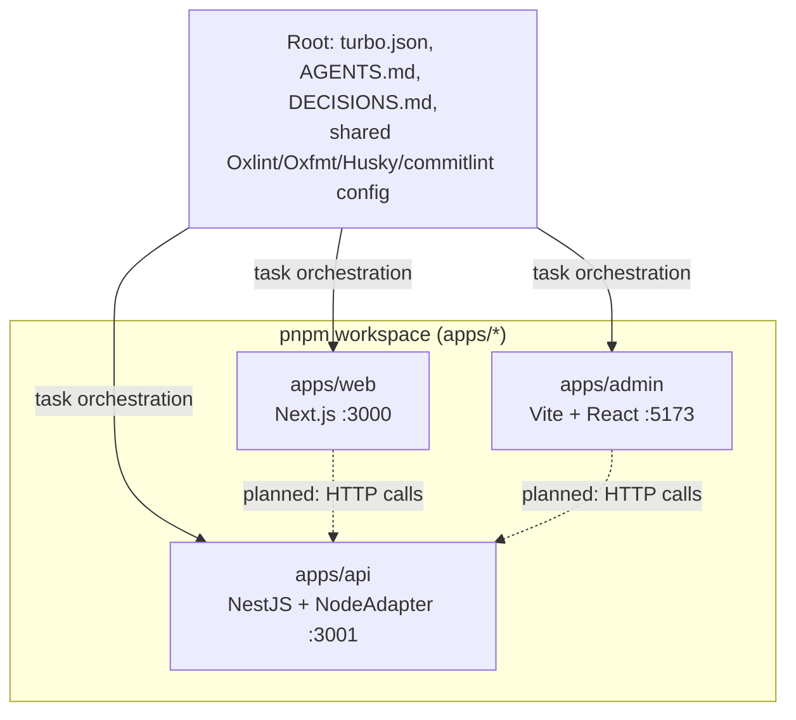

# Monorepo Architecture

Architecture overview of the Neo Bank monorepo. This document describes what is
actually implemented; planned work is marked as such. For a snapshot of the
current development state, see [current-state.md](./current-state.md).

Repository-wide agent instructions live in the root [AGENTS.md](../AGENTS.md);
architectural decisions are recorded in [DECISIONS.md](../DECISIONS.md) and
referenced below as ADR-XXX.

## Repository Overview

Neo Bank is an early-stage banking product consisting of a NestJS API, a
Next.js customer web application, and a React (Vite) admin dashboard. It is a
TypeScript pnpm-workspace monorepo orchestrated by Turborepo
([ADR-001](../DECISIONS.md)).

- **Package manager:** pnpm 12 (`packageManager` field, `pnpm-workspace.yaml`).
- **Node.js:** 24.20.0 (`.nvmrc`, `engines.node`: `>=24.15 <25`).
- **Workspaces:** `apps/*` only. There are currently **no shared packages**;
  the `packages/` directory does not exist.
- **Tooling:** Oxlint (linting) and Oxfmt (formatting) in every workspace;
  Turborepo runs the same task names in all of them.
- **Git hooks:** Husky + lint-staged (format/lint staged files on commit),
  commitlint (Conventional Commits), `pnpm test` on pre-push.

## Applications

| Application     | Path         | Stack                                   | Default port | Status             |
| --------------- | ------------ | --------------------------------------- | ------------ | ------------------ |
| API             | `apps/api`   | NestJS 12, Node HTTP platform, SWC, ESM | 3001         | Active development |
| Web (customer)  | `apps/web`   | Next.js 16 (App Router), React 19       | 3000         | Bare scaffold      |
| Admin dashboard | `apps/admin` | Vite 8, React 19                        | 5173         | Bare scaffold      |

Per-application architecture, conventions, and onboarding guides:

- `apps/api`: [AGENTS.md](../apps/api/AGENTS.md) · [ONBOARDING.md](../apps/api/ONBOARDING.md)
- `apps/web`: [AGENTS.md](../apps/web/AGENTS.md) · [ONBOARDING.md](../apps/web/ONBOARDING.md)
- `apps/admin`: [AGENTS.md](../apps/admin/AGENTS.md) · [ONBOARDING.md](../apps/admin/ONBOARDING.md)

## Workspace Relationships

There are no internal runtime dependencies between the applications. Each
workspace is self-contained; the web and admin frontends do not yet call the
API (no API client code exists in either frontend).

Dashed edges are planned, not implemented. Because there are no workspace-to-
workspace dependencies, Turborepo's `^build`-style dependency chaining has no
internal consumers yet; it becomes relevant when a `packages/` workspace is
introduced.

## Task Orchestration (Turborepo)

`turbo.json` defines the task pipeline. Every application's `package.json`
implements the subset of these scripts that applies to it, and the root
`package.json` delegates via `turbo <task>`:

| Task                                        | Behavior                                                                                                                |
| ------------------------------------------- | ----------------------------------------------------------------------------------------------------------------------- |
| `dev`                                       | Not cached, persistent (watch/dev servers).                                                                             |
| `build`                                     | `dependsOn: ["^build"]`; outputs `dist/**` and Next.js `.next/**` (cache exclusions for `.next/cache` and `.next/dev`). |
| `lint`, `format:check`, `typecheck`, `test` | `dependsOn: ["^lint"]` etc. (dependency-first ordering).                                                                |
| `test:e2e`                                  | No dependency ordering; only `apps/api` implements it.                                                                  |
| `clean`                                     | Not cached.                                                                                                             |

Root-level `pnpm format` is a direct `oxfmt --write .` call over the whole
repository (not a Turbo task), so formatting is repository-wide.

## Architectural Boundaries

- **Workspace boundaries:** applications must not reach into each other's
  source trees; cross-workspace sharing would go through a published-internal
  package under `packages/` (none exists yet).
- **API module boundaries:** feature code lives under
  `apps/api/src/modules/<feature>/`; cross-cutting infrastructure (config,
  logging, database, Redis, errors, filters, interceptors, pipes, HTTP
  helpers, i18n)
  lives under `apps/api/src/shared/` and is exposed through Node.js `#`
  subpath import aliases. See `apps/api/AGENTS.md` for the details.
- **Configuration boundary (API):** `process.env` may be read only once, in
  `apps/api/src/shared/config/env/env.config.ts` (ADR-004, enforced by the
  oxlint `no-process-env` rule with a single override). All other
  configuration access goes through `ConfigService` and namespaced factories.
- **Logging boundary:** the Pino logger (ADR-008/009) is the only logging
  architecture. The centralized pipeline (ADR-022) collects container
  stdout as-is — it never replaces the application logger, and the optional
  `LOG_PRETTY` env override is the single compatibility knob.
- **Bootstrap boundary (API):** all bootstrap-time HTTP configuration (HTTP
  adapter options, request-ID lifecycle, root not-found fallback, global
  prefix, URI versioning, CORS) lives in the `bootstrap` function in
  `apps/api/src/main.ts` and must not be extracted. The API runs on the
  official Node HTTP platform (`NodeAdapter`, ADR-032).
- **Response/error contracts (API):** success responses use the global
  response envelope (exclusions in [ADR-011](../DECISIONS.md)); errors use
  RFC 9457 Problem Details carrying the request ID
  ([ADR-010](../DECISIONS.md)). Both are application-global and covered by
  contract tests; their machine-readable members are language-independent,
  human-readable messages localize through the i18n module
  ([ADR-021](../DECISIONS.md)).

## Communication

- **Client → API:** not implemented yet. The API exposes
  `http://localhost:3001` (prefix `/api/v1`, health at `/health`), but neither
  frontend contains HTTP client code, shared types, or an API SDK.
- **API ↔ infrastructure:** Redis is the first external integration: a
  global `RedisModule` (`apps/api/src/shared/redis/`, ADR-012/013) owns one
  ioredis client and exposes it through a `RedisService` abstraction;
  connection settings are validated at boot, while an unreachable server
  only degrades the `/health` endpoint (HTTP 200) and never blocks startup.
  Consumers: the enrollments challenge (OTP storage), global HTTP rate
  limiting (ADR-015), and the idempotency store (ADR-039) — all use the
  shared connection and the standardized
  key naming convention. PostgreSQL persistence follows a similar pattern
  (ADR-027, amended 2026-11-14): a global `DatabaseModule`
  (`apps/api/src/shared/database/`) owns the single MikroORM v7 instance;
  the initial connection is established during bootstrap with bounded
  retries and startup fails when the database cannot be reached, while
  post-boot outages apply the identical health contract (degraded `/health`,
  strict `/health/ready`); after boot, a pool-level lifecycle logger
  (ADR-034) logs new physical connections and pool errors through the
  application logger. The first feature entity exists: `Enrollment` (table
  `enrollments`, ADR-041) inherits the shared abstract `BaseEntity`
  ([ADR-029](../DECISIONS.md)) columns (BIGINT primary key, `timestamptz(3)`
  timestamps, actor audit attribution, optimistic-lock version, soft-delete
  surface) and adds the core lifecycle fields: `phone_number` (canonical
  national format `09XXXXXXXXX`, `varchar(11)` format CHECK), `public_id`
  (uuid with the database-native `uuidv7()` default per ADR-040, unique,
  version-7 CHECK — the only client-visible identifier), `status` and
  `current_step` (CHECK-constrained text lifecycle values, defaults
  `INITIAL` and `NATIONAL_CODE`), and `expires_at` (`timestamptz(3)` NOT
  NULL, application-set `createdAt` + 24 h, no database default). A partial
  unique index (`WHERE status <> 'EXPIRED'`) enforces the
  one-non-expired-Enrollment-per-phone invariant. Two migrations
  (`Migration20261116181139`, `Migration20261122000737`) are applied to the
  dev PostgreSQL; migrations are immutable and gated by the dedicated
  `migration-reviewer` subagent (ADR-033). A UTC-first TIMESTAMPTZ storage
  policy ([ADR-030](../DECISIONS.md)) governs
  how timestamps are stored and converted — developer guide:
  [utc-datetime.md](./utc-datetime.md). No feature flow persists rows yet.
- **Applications ↔ observability:** none at runtime. The monitoring stack
  (`docker/compose.monitoring.yml`, ADR-022) is a separate Compose project with its
  own network; Grafana Alloy collects container stdout/stderr through the
  Docker daemon socket and ships it to Loki, so applications neither know
  about monitoring nor depend on it. Details: `docs/observability/README.md`.

## Current Architectural Limitations

- No shared packages: types, validation schemas, and API contracts cannot be
  shared between the API and frontends yet; they would be duplicated today.
- The persistence layer has no feature writes yet: MikroORM v7 and
  PostgreSQL are wired in (ADR-027) with migrations configured, and the
  first feature entity exists (`Enrollment`, table `enrollments`, ADR-029
  base columns plus the ADR-041 core lifecycle schema), but no application
  flow persists rows.
- No authentication/authorization anywhere.
- The frontends are scaffolds: no routing beyond the index page, no state
  management, no styling system, no tests.
- E2e tests exist only for the API; web and admin have no test setup at all.
