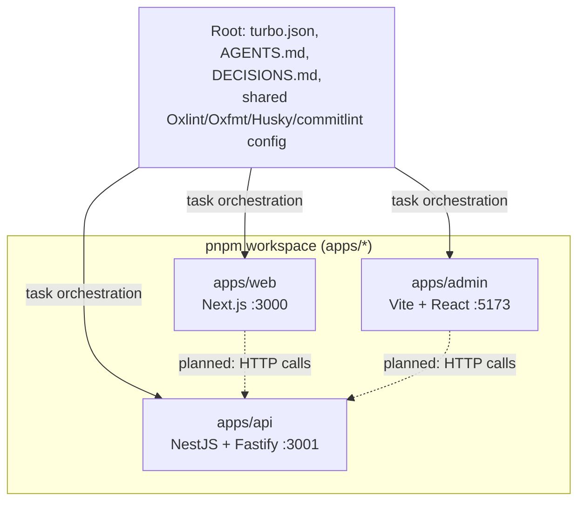

# Monorepo Architecture

Architecture overview of the Neo Bank monorepo. This document describes what is
actually implemented; planned work is marked as such. For a snapshot of the
current development state, see [current-state.md](./current-state.md).

Repository-wide agent instructions live in the root [AGENTS.md](../AGENTS.md);
architectural decisions are recorded in [DECISIONS.md](../DECISIONS.md) and
referenced below as ADR-XXX.

## Repository Overview

Neo Bank is an early-stage banking product consisting of a NestJS API, a
Next.js customer web application, and a React (Vite) admin dashboard. It is a
TypeScript pnpm-workspace monorepo orchestrated by Turborepo
([ADR-001](../DECISIONS.md)).

- **Package manager:** pnpm 12 (`packageManager` field, `pnpm-workspace.yaml`).
- **Node.js:** 24.20.0 (`.nvmrc`, `engines.node`: `>=24.15 <25`).
- **Workspaces:** `apps/*` only. There are currently **no shared packages**;
  the `packages/` directory does not exist.
- **Tooling:** Oxlint (linting) and Oxfmt (formatting) in every workspace;
  Turborepo runs the same task names in all of them.
- **Git hooks:** Husky + lint-staged (format/lint staged files on commit),
  commitlint (Conventional Commits), `pnpm test` on pre-push.

## Applications

| Application     | Path         | Stack                             | Default port | Status             |
| --------------- | ------------ | --------------------------------- | ------------ | ------------------ |
| API             | `apps/api`   | NestJS 12, Fastify, SWC, ESM      | 3001         | Active development |
| Web (customer)  | `apps/web`   | Next.js 16 (App Router), React 19 | 3000         | Bare scaffold      |
| Admin dashboard | `apps/admin` | Vite 8, React 19                  | 5173         | Bare scaffold      |

Per-application architecture, conventions, and onboarding guides:

- `apps/api`: [AGENTS.md](../apps/api/AGENTS.md) · [ONBOARDING.md](../apps/api/ONBOARDING.md)
- `apps/web`: [AGENTS.md](../apps/web/AGENTS.md) · [ONBOARDING.md](../apps/web/ONBOARDING.md)
- `apps/admin`: [AGENTS.md](../apps/admin/AGENTS.md) · [ONBOARDING.md](../apps/admin/ONBOARDING.md)

## Workspace Relationships

There are no internal runtime dependencies between the applications. Each
workspace is self-contained; the web and admin frontends do not yet call the
API (no API client code exists in either frontend).

Dashed edges are planned, not implemented. Because there are no workspace-to-
workspace dependencies, Turborepo's `^build`-style dependency chaining has no
internal consumers yet; it becomes relevant when a `packages/` workspace is
introduced.

## Task Orchestration (Turborepo)

`turbo.json` defines the task pipeline. Every application's `package.json`
implements the subset of these scripts that applies to it, and the root
`package.json` delegates via `turbo <task>`:

| Task                                        | Behavior                                                                                                                |
| ------------------------------------------- | ----------------------------------------------------------------------------------------------------------------------- |
| `dev`                                       | Not cached, persistent (watch/dev servers).                                                                             |
| `build`                                     | `dependsOn: ["^build"]`; outputs `dist/**` and Next.js `.next/**` (cache exclusions for `.next/cache` and `.next/dev`). |
| `lint`, `format:check`, `typecheck`, `test` | `dependsOn: ["^lint"]` etc. (dependency-first ordering).                                                                |
| `test:e2e`                                  | No dependency ordering; only `apps/api` implements it.                                                                  |
| `clean`                                     | Not cached.                                                                                                             |

Root-level `pnpm format` is a direct `oxfmt --write .` call over the whole
repository (not a Turbo task), so formatting is repository-wide.

## Architectural Boundaries

- **Workspace boundaries:** applications must not reach into each other's
  source trees; cross-workspace sharing would go through a published-internal
  package under `packages/` (none exists yet).
- **API module boundaries:** feature code lives under
  `apps/api/src/modules/<feature>/`; cross-cutting infrastructure (config,
  logging, errors, filters, interceptors, pipes, HTTP helpers) lives under
  `apps/api/src/shared/` and is exposed through Node.js `#` subpath import
  aliases. See `apps/api/AGENTS.md` for the details.
- **Configuration boundary (API):** `process.env` may be read only once, in
  `apps/api/src/shared/config/env/env.config.ts` (ADR-004, enforced by the
  oxlint `no-process-env` rule with a single override). All other
  configuration access goes through `ConfigService` and namespaced factories.
- **Bootstrap boundary (API):** all bootstrap-time HTTP configuration (Fastify
  adapter options, global prefix, URI versioning, CORS) lives in the
  `bootstrap` function in `apps/api/src/main.ts` and must not be extracted.
- **Response/error contracts (API):** success responses use the global
  response envelope (exclusions in [ADR-011](../DECISIONS.md)); errors use
  RFC 9457 Problem Details carrying the request ID
  ([ADR-010](../DECISIONS.md)). Both are application-global and covered by
  contract tests.

## Communication

- **Client → API:** not implemented yet. The API exposes
  `http://localhost:3001` (prefix `/api/v1`, health at `/health`), but neither
  frontend contains HTTP client code, shared types, or an API SDK.
- **API ↔ infrastructure:** none. No database, cache, message broker, or
  external service is connected; the only integration is the Terminus health
  check (currently self-referential, no downstream indicators).

## Current Architectural Limitations

- No shared packages: types, validation schemas, and API contracts cannot be
  shared between the API and frontends yet; they would be duplicated today.
- No persistence layer: the API is stateless and in-memory only.
- No authentication/authorization anywhere.
- The frontends are scaffolds: no routing beyond the index page, no state
  management, no styling system, no tests.
- E2e tests exist only for the API; web and admin have no test setup at all.
